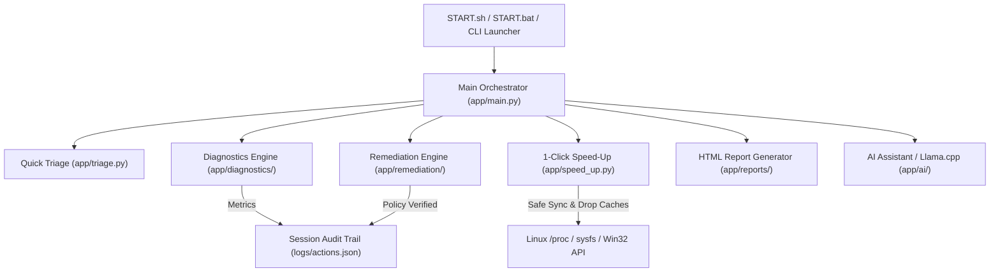

<div align="center">

# ⚡ PortableSysAdmin
### The Ultimate Open-Source SysAdmin Diagnostic, Remediation & 1-Click System Speed-Up Toolkit

[](https://github.com/vishv3010/PortableSysAdmin/actions/workflows/ci.yml)
[](LICENSE)
[]()
[]()
[]()
[](CONTRIBUTING.md)
[](https://github.com/vishv3010/PortableSysAdmin/stargazers)

<p align="center">
  <b>Diagnose • Optimize • Repair • Recover • Accelerate</b><br>
  Engineered for System Administrators, IT Support Specialists, and Power Users.<br>
  Works natively on <b>Ubuntu / Debian Linux</b> and <b>Windows 10 / 11 / Server</b>.
</p>

[Quick Install](#-1-line-instant-installation) • [Key Features](#-key-features) • [Terminal Showcase](#-interactive-terminal-ui) • [Architecture](#-architecture) • [Safety Model](#-enterprise-safety-guarantee) • [Docs](POCKET_REFERENCE.html)

</div>

---

## 🚀 1-Line Instant Installation

Install and run on any machine worldwide in **under 3 seconds** without manual cloning or configuration:

### 🐧 Linux (Ubuntu, Debian, Linux Mint, Pop!_OS)
```bash
curl -sSL https://raw.githubusercontent.com/vishv3010/PortableSysAdmin/master/install.sh | sudo bash
```

### 🪟 Windows (10, 11, Windows Server)
Open PowerShell as Administrator:
```powershell
irm https://raw.githubusercontent.com/vishv3010/PortableSysAdmin/master/install.ps1 | iex
```

> **After installing:** Simply run `portablesysadmin` from any terminal or launch it from your Desktop / Application Menu!

---

## 💾 Zero-Install Modes

### 1. Portable USB Mode (Run Directly from USB)
Plug in your flash drive on any client machine and run:
* **Linux:** `chmod +x START.sh && ./START.sh`
* **Windows:** Double-click `START.bat` (or Run as Administrator)

### 2. Standard Debian / Ubuntu Package (`.deb`)
```bash
sudo apt install ./portablesysadmin_1.0.0_all.deb
```
*(Only **38 KB** — builds instantly with `./build_deb.sh`)*

---

## 🌟 Key Features

<table>
  <tr>
    <td width="50%">
      <h3>🚀 1-Click Safe System Speed-Up</h3>
      <ul>
        <li><b>100% Zero Data Loss:</b> Never kills user applications and never touches personal files.</li>
        <li><b>RAM Cache Flush:</b> Safely commits dirty buffers with <code>sync</code> then drops clean pagecache/inodes to reclaim gigabytes of memory.</li>
        <li><b>Memory Compaction:</b> Defragments free RAM pools for instantaneous application launch.</li>
        <li><b>Log & Disk Vacuum:</b> Trims bloated <code>systemd-journald</code> logs to 100MB and purges package installer archives.</li>
        <li><b>CPU Unthrottling:</b> Restores throttled <code>powersave</code> frequencies to high performance.</li>
      </ul>
    </td>
    <td width="50%">
      <h3>🩺 2-Second Quick Triage</h3>
      <ul>
        <li>Rapid-fire scorecard across <b>RAM</b>, <b>Root Disk</b>, <b>Network/DNS</b>, and <b>CPU Load</b>.</li>
        <li>Instant bottleneck detection with a 1-click prompt to auto-remediate.</li>
        <li>Identifies network drops and DNS timeout anomalies within 1.5 seconds.</li>
      </ul>
    </td>
  </tr>
  <tr>
    <td width="50%">
      <h3>🌡️ Thermal & "Ghost CPU" Diagnostics</h3>
      <ul>
        <li>Diagnoses the <b>Thermal PROCHOT Illusion</b> where laptops appear at 100% CPU because overheating downclocked the clock to 0.79 GHz.</li>
        <li>Monitors live hardware core temperatures across all thermal zones.</li>
        <li>Eliminates swap thrashing that drives continuous NVMe and bus heat generation.</li>
      </ul>
    </td>
    <td width="50%">
      <h3>🛡️ Safe Remediation Engine</h3>
      <ul>
        <li>Strict risk classification: <code>SAFE</code>, <code>CONFIRMATION_REQUIRED</code>, and <code>DANGEROUS</code>.</li>
        <li>Full <b>Dry-Run Mode</b> to inspect commands before executing.</li>
        <li>Auto-fixes for Wi-Fi adapters, network stacks, frozen display shells, and broken package managers.</li>
      </ul>
    </td>
  </tr>
  <tr>
    <td width="50%">
      <h3>📊 Enterprise HTML Reporting</h3>
      <ul>
        <li>Generates standalone HTML diagnostic dashboards with responsive metric tables.</li>
        <li>Includes a <b>1-Click Copy AI Prompt</b> button designed for ChatGPT / Claude (0% CPU background load).</li>
      </ul>
    </td>
    <td width="50%">
      <h3>🤖 Local Offline AI Assistant</h3>
      <ul>
        <li>Embedded offline GGUF local model execution via <code>llama.cpp</code>.</li>
        <li>Runs on-demand for air-gapped systems with zero internet dependency.</li>
      </ul>
    </td>
  </tr>
</table>

---

## 🖥️ Interactive Terminal UI

```text
  _____           _        _     _        
 |  __ \         | |      | |   | |       
 | |__) |__  _ __| |_ __ _| |__ | | ___   
 |  ___/ _ \| '__| __/ _` | '_ \| |/ _ \  
 | |  | (_) | |  | || (_| | |_) | |  __/  
 |_|   \___/|_|   \__\__,_|_.__/|_|\___|  
                                          
      SYSADMIN TROUBLESHOOTING TOOLKIT

[+] System:  Ubuntu (24.04)
[+] Host:    addweb-ThinkPad-Yoga-260
[+] Access:  ROOT/ADMIN
[+] Session: 20260910_110000
==================================================

AVAILABLE MODULES:
  [1] Run Deep System Diagnostics (CPU/RAM/Disk/Security)
  [2] Run Network Diagnostics
  [3] Open Remediation Engine (Auto-Fixes)
  [4] Generate Enterprise HTML Report
  [5] Ask AI For Root Cause Analysis
  
  [6] Quick Triage & Auto-Doctor (Instant 2-Sec Check & 1-Click Fix)
  [7] Instant SysAdmin Command Finder (Offline Cheatsheet)
  [8] Open HTML Pocket Reference Guide (Browser)
  
  [9] 🚀 1-Click Safe System Speed-Up (Zero Data Loss RAM/Disk/CPU Boost)
  
  [0] Exit Toolkit
```

### 📊 Real-Time Speed-Up Scorecard Example

```text
╔══════════════════════════════════════════════════════════════════════════════╗
║                  OPTIMIZATION PERFORMANCE COMPARISON CARD                    ║
╠══════════════════════════════╦═══════════════╦═══════════════╦═══════════════╣
║ Metric                       ║ Before        ║ After         ║ Net Result    ║
╠══════════════════════════════╬═══════════════╬═══════════════╬═══════════════╣
║ Available RAM (Free Pool)    ║ 4.20 GB       ║ 11.53 GB      ║ +7.33 GB Freed║
║ RAM Memory Utilization       ║ 72.8%         ║ 25.5%         ║ Reduced Load  ║
║ Free Disk Space              ║ 18.20 GB      ║ 21.40 GB      ║ +3.20 GB Disk ║
║ CPU Temperature              ║ 80.0°C        ║ 77.0°C        ║ -3.0°C Cool   ║
║ CPU Clock Speed              ║ 0.79 GHz      ║ 2.91 GHz      ║ Unthrottled   ║
║ CPU Governor / Power Plan    ║ powersave     ║ performance   ║ Optimized     ║
║ User Applications & Files    ║ Intact        ║ Intact        ║ 0 Data Loss   ║
╚══════════════════════════════╩═══════════════╩═══════════════╩═══════════════╝
```

---

## 🏗️ Architecture



---

## 🛡️ Enterprise Safety Guarantee

PortableSysAdmin is engineered from day one with a strict **Zero Harm Policy**:

* **Never Kills User Apps:** Browsers, Office applications, IDEs, and active terminal sessions are strictly preserved.
* **Never Modifies Personal Data:** Zero operations are performed on `Desktop`, `Documents`, `Downloads`, or home folders.
* **Pre-Execution Flush:** All volatile file modifications are synced to persistent storage (`sync`) prior to dropping clean RAM caches.
* **Full Audit Trail:** Every action and telemetry reading is logged to `logs/session_<id>/actions.json` for corporate security compliance.

---

## 🧩 Supported Platforms & Matrix

| Feature | Linux (Ubuntu / Debian / Mint) | Windows (10 / 11 / Server) |
| :--- | :---: | :---: |
| **1-Click Safe Speed-Up** | ✅ Full Kernel Cache / Journal Vacuum | ✅ Standby Trim / Temp Purge |
| **Quick Triage** | ✅ 2-Second Health Check | ✅ 2-Second Health Check |
| **Thermal Monitoring** | ✅ Hardware Sysfs Zones | ✅ WMI Thermal Sensors |
| **1-Line Web Installer** | ✅ `curl ... \| sudo bash` | ✅ `irm ... \| iex` |
| **Offline HTML Reports** | ✅ Standalone Dashboard | ✅ Standalone Dashboard |
| **Offline Cheatsheet** | ✅ Instant Command Finder | ✅ Instant Command Finder |

---

## 🤝 Contributing

Contributions make the open-source community an amazing place to learn and build! Any contributions you make are **greatly appreciated**.

See our [Contributing Guide](CONTRIBUTING.md) to get started.

---

## 📄 License

Distributed under the **MIT License**. See [`LICENSE`](LICENSE) for more information.

---

<div align="center">
  <b>Built with ❤️ for SysAdmins worldwide by <a href="https://github.com/vishv3010">Vishv Patel</a></b><br>
  <sub>If you find this toolkit helpful, please consider leaving a ⭐️ on GitHub!</sub>
</div>
